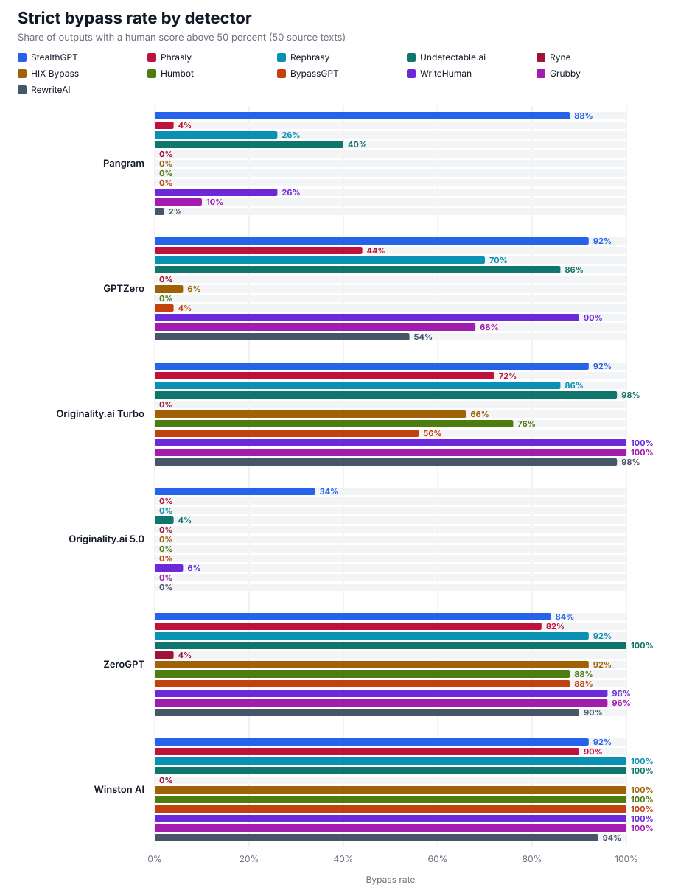
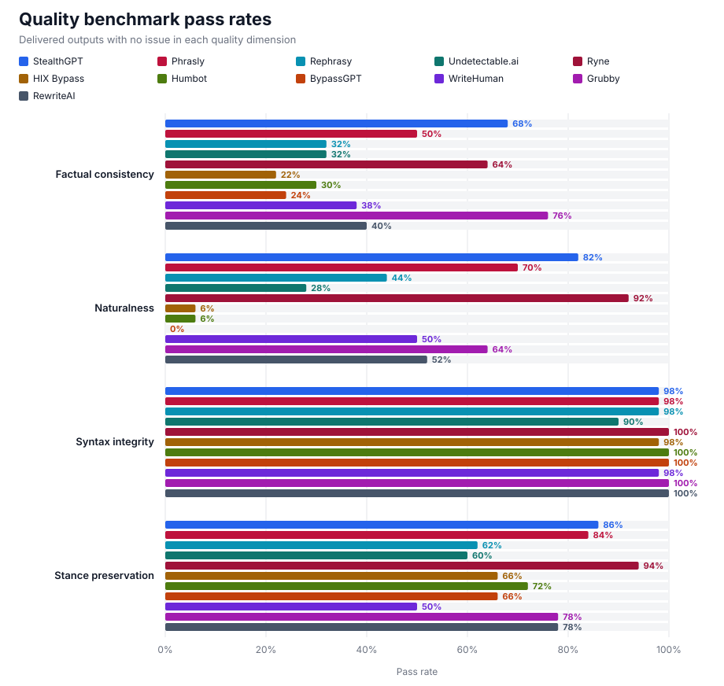

# Humanizer comparison: Benchmark Report

[Terms and methodology](../../README.md)

## Run details

| Field | Value |
|---|---|
| Date | October 22, 2026 |
| Humanizers | StealthGPT, Phrasly, Rephrasy, Undetectable.ai, Ryne, HIX Bypass, Humbot, BypassGPT, WriteHuman, Grubby, RewriteAI |
| Sample | 50 synthetic English texts, 300–1,000 words |
| Source models | GPT-6.1 Sol (10), Claude Sonnet 5.5 (10), Gemini 4 Argon (10), Grok 4.7 (10), DeepSeek V4.1 Flash (10) |
| Selection | Same source texts for every humanizer |
| Detector access | Provider APIs |
| Text evaluated | Same plain-text output sent to every detector |

## Detector results

| Detector | Model | Resolved version |
|---|---:|---:|
| Pangram | v4 | 4.1 |
| GPTZero | `latest` | 2026-10-07-base |
| Originality.ai Turbo | turbo | turbo |
| Originality.ai 5.0 | model-5.0 | model-5.0 |
| ZeroGPT | `default` | — |
| Winston AI | `latest` | 5.0 |

Strict bypass rate:

| Humanizer | Pangram | GPTZero | Originality.ai Turbo | Originality.ai 5.0 | ZeroGPT | Winston AI |
|---|---:|---:|---:|---:|---:|---:|
| StealthGPT | 88% | 92% | 92% | 34% | 84% | 92% |
| Phrasly | 4% | 44% | 72% | 0% | 82% | 90% |
| Rephrasy | 26% | 70% | 86% | 0% | 92% | 100% |
| Undetectable.ai | 40% | 86% | 98% | 4% | 100% | 100% |
| Ryne | 0% | 0% | 0% | 0% | 4% | 0% |
| HIX Bypass | 0% | 6% | 66% | 0% | 92% | 100% |
| Humbot | 0% | 0% | 76% | 0% | 88% | 100% |
| BypassGPT | 0% | 4% | 56% | 0% | 88% | 100% |
| WriteHuman | 26% | 90% | 100% | 6% | 96% | 100% |
| Grubby | 10% | 68% | 100% | 0% | 96% | 100% |
| RewriteAI | 2% | 54% | 98% | 0% | 90% | 94% |
| No humanizer (source text) | 0% | 0% | 0% | 0% | 2% | 0% |

Originality.ai 5.0 verdicts:

| Humanizer | Likely Original | Mixed | Likely AI |
|---|---:|---:|---:|
| StealthGPT | 30% | 12% | 58% |
| Phrasly | 0% | 8% | 92% |
| Rephrasy | 0% | 46% | 54% |
| Undetectable.ai | 0% | 26% | 74% |
| Ryne | 0% | 0% | 100% |
| HIX Bypass | 0% | 0% | 100% |
| Humbot | 0% | 2% | 98% |
| BypassGPT | 0% | 2% | 98% |
| WriteHuman | 0% | 24% | 76% |
| Grubby | 0% | 6% | 94% |
| RewriteAI | 0% | 0% | 100% |
| No humanizer (source text) | 0% | 0% | 100% |

## Quality results

| Humanizer | Factual consistency | Naturalness | Syntax integrity | Stance preservation |
|---|---:|---:|---:|---:|
| StealthGPT | 68% | 82% | 98% | 86% |
| Phrasly | 50% | 70% | 98% | 84% |
| Rephrasy | 32% | 44% | 98% | 62% |
| Undetectable.ai | 32% | 28% | 90% | 60% |
| Ryne | 64% | 92% | 100% | 94% |
| HIX Bypass | 22% | 6% | 98% | 66% |
| Humbot | 30% | 6% | 100% | 72% |
| BypassGPT | 24% | 0% | 100% | 66% |
| WriteHuman | 38% | 50% | 98% | 50% |
| Grubby | 76% | 64% | 100% | 78% |
| RewriteAI | 40% | 52% | 100% | 78% |

## Notes

- Each source text was written by one of the listed models from a fixed writing prompt and kept only if it landed between 300 and 1,000 words.
- Humanizers received each source text exactly as published in the source-text file. Detectors received plain text with Markdown heading markers, bullet markers, and bold markers removed.
- Originality.ai 5.0 reports the share of the text it judges AI-written rather than a confidence score, so its human score is not comparable with Turbo's.

## Files

- [Source texts with prompts and models](data/source-texts.csv)
- [Anonymized per-output scores](data/scores.csv)
- [Machine-readable summary](data/summary.json)
