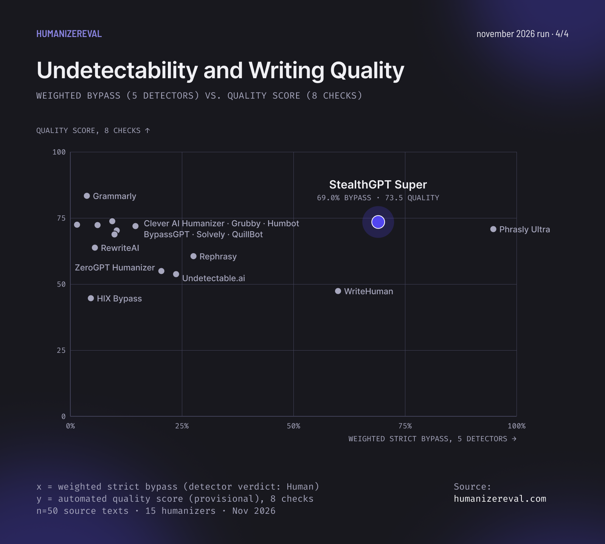

# November 2026 humanizer comparison

[Terms and methodology](../../README.md)

## Run details

| Field | Value |
|---|---|
| Completed | November 17, 2026 (America/Los_Angeles) |
| Inputs | 50 frozen synthetic English texts; five source model families, ten texts each |
| Humanizers | 15 services; 50 outputs each, 750 outputs total |
| Detector panel | Pangram 4.1; GPTZero 5.0b; Originality.ai 5.0; Winston AI 5.2; ZeroGPT vendor-managed |
| Detector evaluations | 3,750 completed scores, all on the same frozen humanizer outputs |
| Overall score | 70% weighted strict bypass + 30% provisional automated quality |

## Results

| Humanizer | Overall /100 | Weighted bypass | Quality /100 | Length ratio |
|---|---:|---:|---:|---:|
| Phrasly Ultra | 87.60 | 94.80% | 70.80 | 0.93 |
| StealthGPT Super | 70.34 | 69.00% | 73.48 | 1.08 |
| WriteHuman | 56.21 | 60.00% | 47.38 | 1.04 |
| Rephrasy | 37.49 | 27.60% | 60.56 | 1.11 |
| Undetectable.ai | 32.72 | 23.70% | 53.76 | 1.22 |
| Clever Humanizer | 31.80 | 14.60% | 71.94 | 1.00 |
| ZeroGPT Humanizer | 30.76 | 20.40% | 54.94 | 1.21 |
| BypassGPT | 28.71 | 9.40% | 73.78 | 1.42 |
| Grubby | 28.36 | 10.40% | 70.28 | 1.19 |
| Grammarly Pro | 27.60 | 3.70% | 83.38 | 1.23 |
| Humbot | 27.56 | 9.90% | 68.78 | 1.41 |
| Solvely | 25.97 | 6.10% | 72.32 | 1.15 |
| RewriteAI | 22.98 | 5.50% | 63.78 | 1.22 |
| QuillBot | 22.79 | 1.50% | 72.46 | 1.04 |
| HIX Bypass | 16.62 | 4.60% | 44.66 | 1.15 |

Length ratio is the mean of per-output output-word/input-word ratios and does not affect scores. Quality is a score, not a pass rate. All 750 outputs have quality and all five detector results. 602 outputs retain evidence-review flags; these are not 602 confirmed defective outputs. Automated quality remains provisional and has not been independently human-adjudicated.



## Detector pass rules and weights

| Detector | Weight | Strict-human rule |
|---|---:|---|
| Pangram | 40% | pangram_prediction == Human |
| GPTZero | 30% | gptzero_predicted_class == human |
| Originality.ai 5.0 | 20% | originality_prediction_label == human |
| Winston AI | 5% | winston_human_score >= 80; benchmark mapping, not a native categorical verdict |
| ZeroGPT | 5% | Unqualified Human Written or Most Likely Human written feedback only |

Native human scores have different vendor meanings and are not averaged across vendors. Mixed, uncertain and AI outcomes fail the strict-human rule; Winston uses the explicit document-score mapping shown above. Originality Turbo and Max are excluded. This measures bypass on humanized text, not detector accuracy or human false-positive rates.

## Quality dimensions

| Metric | Weight |
|---|---:|
| Readability and naturalness | 25% |
| Meaning preservation | 20% |
| Structure and coherence | 15% |
| Factual consistency | 10% |
| Completeness | 10% |
| Grammar and syntax | 10% |
| Hallucinations (higher means fewer unsupported additions) | 5% |
| Stance preservation | 5% |

The public release exposes dimension scores and arithmetic weights. It does not expose production judge prompts, internal schemas, model routing, thresholds, repair logic or private code references. Source-generation prompts in the input CSV are separate from private evaluation instructions.

## Model settings and per-humanizer results

| Humanizer | Collection | Recorded setting | Public results |
|---|---|---|---|
| Phrasly Ultra | API | Ultra; Max mode; account access verified during collection | [50 anonymized rows](data/humanizers/phrasly.csv) |
| StealthGPT Super | API | Super; rephrase=true; qualityMode=quality; outputFormat=text | [50 anonymized rows](data/humanizers/stealth.csv) |
| WriteHuman | API | Enhanced | [50 anonymized rows](data/humanizers/writehuman.csv) |
| Rephrasy | API | Superstealth | [50 anonymized rows](data/humanizers/rephrasy.csv) |
| Undetectable.ai | API | v11sr; University; General Writing; More Human | [50 anonymized rows](data/humanizers/undetectableai.csv) |
| Clever Humanizer | web interface | Normal; automatic Best Pick | [50 anonymized rows](data/humanizers/clever.csv) |
| ZeroGPT Humanizer | API | v11sr; University; General Writing; More Human | [50 anonymized rows](data/humanizers/zerogpt-humanizer.csv) |
| BypassGPT | API | Enhanced | [50 anonymized rows](data/humanizers/bypassgpt.csv) |
| Grubby | API | Academic | [50 anonymized rows](data/humanizers/grubby.csv) |
| Grammarly Pro | web interface | Pro; The Naturalist; only Humanizer rewrites applied | [50 anonymized rows](data/humanizers/grammarly-pro.csv) |
| Humbot | API | Advanced | [50 anonymized rows](data/humanizers/humbot.csv) |
| Solvely | web interface | Humanize; Original result | [50 anonymized rows](data/humanizers/solvely.csv) |
| RewriteAI | API | Single available API model | [50 anonymized rows](data/humanizers/rewriteai.csv) |
| QuillBot | web interface | Premium; Standard | [50 anonymized rows](data/humanizers/quillbot.csv) |
| HIX Bypass | API | Latest | [50 anonymized rows](data/humanizers/hix.csv) |

The four web-collected cohorts are Grammarly Pro, QuillBot, Solvely and Clever Humanizer. Earlier pilots and the earlier public-tool Grammarly run are excluded. No detector-guided output selection or benchmark-side output repair is claimed. The recorded settings describe the actual run, not a claim that all vendor modes are equivalent.

## What anyone can verify without the outputs

1. Download this report and run the verifier below, which uses Python standard-library modules only.
2. Verify every released file against `manifest.json` and its deterministic file-tree digest.
3. Recompute the hashes and word counts of all 50 published source texts.
4. Check all 750 humanizer/sample pairs, their source/output commitments and the 15 matching per-humanizer score files.
5. Recompute native detector passes, quality composites, overall composites, medians, length ratios and every published summary aggregate.

```sh
git clone https://github.com/StealthGPT-Labs/humanizer-benchmark.git
cd humanizer-benchmark
python3 scripts/verify_november_report.py reports/2026-11-17-humanizer-comparison
```

The output commitments are SHA-256 hashes of exact UTF-8 text, without trimming or newline normalization. Before release, the operator recomputed all 750 output hashes and cross-checked the retained captures and all five saved detector tables. [Provenance](data/provenance.json) includes commitments to those retained private files.

**Verification limit:** a hash can establish consistency with a file supplied later; it cannot independently prove which service produced undisclosed text. The public verifier proves public-data integrity and arithmetic consistency, not vendor authenticity or the correctness of the private quality judgments. Raw humanized text and text/score pairs remain withheld, as in October.

## Policy changes and limitations

- The weights were revised after results were visible. Winston was reduced from 15% to 5%; the final whole-number detector weights are 40/30/20/5/5. Overall changed from a multiplicative bypass/quality score to the final 70/30 weighted sum. These are disclosed editorial choices, not a preregistered or independently calibrated detector-strength estimate.
- No new unchanged-AI detector baseline or held-out verified-human false-positive audit was run in November. Results apply to this English corpus, recorded modes and detector versions. Detector outputs can be correlated.
- Ryne was excluded following weak previous results and an operator-reported preliminary observation that its latest model remained detectable. September had 59/250 detector checks pass; October had 2/300, on ZeroGPT only. The preliminary observation is not a scored November submission.
- November uses different pass rules, a five-detector panel and eight weighted quality metrics. Scores are not directly comparable with the older editions.
- Built by the StealthGPT team; its product participates. This is not independent third-party validation.

## Public files

- [All 750 anonymized score rows](data/scores.csv)
- [Per-humanizer score files](data/humanizers/)
- [50 source texts, prompts and models](data/source-texts.csv)
- [750 source/output commitments, without humanized text](data/output-commitments.csv)
- [Recomputable summary](data/summary.json)
- [Scoring policy](data/methodology.json)
- [Sanitized provenance and private-evidence commitments](data/provenance.json)
- [File integrity manifest](manifest.json)
