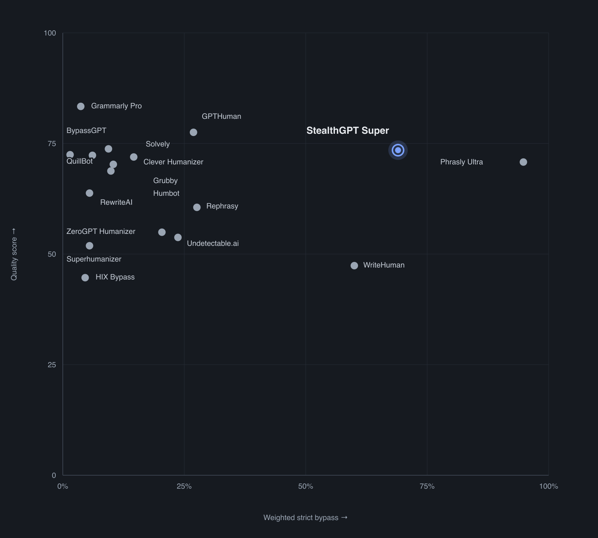

# November 26, 2026 humanizer comparison

[Terms and methodology](../../README.md)

**November 26 addition:** GPTHuman was collected through its signed-in web interface using the Plus plan, Enhanced mode and College tone. Its 50 outputs were added to the 800-output November 18 edition. Earlier outputs were not rerun.

## Run details

| Field | Value |
|---|---|
| Completed | November 26, 2026 (America/Los_Angeles) |
| Inputs | 50 frozen synthetic English texts; five source model families, ten texts each |
| Humanizers | 17 services; 50 outputs each, 850 outputs total |
| Detector panel | Pangram 4.1; GPTZero 5.0b; Originality.ai 5.0; Winston AI 5.2; ZeroGPT vendor-managed |
| Detector evaluations | 4,250 scores; five detectors on every saved output |
| Overall score | 70% weighted strict bypass + 30% provisional automated quality |

## Results

| Rank | Humanizer | Overall /100 | Weighted bypass | Quality /100 | Length ratio |
|---:|---|---:|---:|---:|---:|
| 1 | Phrasly Ultra | 87.60 | 94.80% | 70.80 | 0.93 |
| 2 | StealthGPT Super | 70.34 | 69.00% | 73.48 | 1.08 |
| 3 | WriteHuman | 56.21 | 60.00% | 47.38 | 1.04 |
| 4 | GPTHuman | 42.09 | 26.90% | 77.52 | 1.23 |
| 5 | Rephrasy | 37.49 | 27.60% | 60.56 | 1.11 |
| 6 | Undetectable.ai | 32.72 | 23.70% | 53.76 | 1.22 |
| 7 | Clever Humanizer | 31.80 | 14.60% | 71.94 | 1.00 |
| 8 | ZeroGPT Humanizer | 30.76 | 20.40% | 54.94 | 1.21 |
| 9 | BypassGPT | 28.71 | 9.40% | 73.78 | 1.42 |
| 10 | Grubby | 28.36 | 10.40% | 70.28 | 1.19 |
| 11 | Grammarly Pro | 27.60 | 3.70% | 83.38 | 1.23 |
| 12 | Humbot | 27.56 | 9.90% | 68.78 | 1.41 |
| 13 | Solvely | 25.97 | 6.10% | 72.32 | 1.15 |
| 14 | RewriteAI | 22.98 | 5.50% | 63.78 | 1.22 |
| 15 | QuillBot | 22.79 | 1.50% | 72.46 | 1.04 |
| 16 | Superhumanizer | 19.41 | 5.50% | 51.88 | 0.98 |
| 17 | HIX Bypass | 16.62 | 4.60% | 44.66 | 1.15 |

Length ratio is the mean output-word/input-word ratio and does not affect scores. Quality is a score, not a pass rate. All 850 outputs have quality scores and five detector results. 672 outputs retain evidence-review flags; these are review requests, not confirmed defects. Automated quality is provisional and has not been independently human-adjudicated.

## Detector pass rules and weights

| Detector | Weight | Strict-human rule |
|---|---:|---|
| Pangram | 40% | Native Human classification only |
| GPTZero | 30% | predicted_class=human |
| Originality.ai 5.0 | 20% | prediction_label=human |
| Winston AI | 5% | Document human score at least 80; benchmark mapping |
| ZeroGPT | 5% | Unqualified Human Written or Most Likely Human written |

Native human scores have vendor-specific meanings and are not averaged across vendors. Mixed, uncertain and AI outcomes fail the strict-human rule. This measures detector outcomes on these outputs, not detector accuracy or human false-positive rates.

## Quality dimensions

| Metric | Weight |
|---|---:|
| Readability and naturalness | 25% |
| Meaning preservation | 20% |
| Structure and coherence | 15% |
| Factual consistency | 10% |
| Completeness | 10% |
| Grammar and syntax | 10% |
| Hallucinations (higher means fewer unsupported additions) | 5% |
| Stance preservation | 5% |

The public release exposes dimension scores and weights. It withholds production judge instructions, internal schemas, routing, thresholds, repair logic and private code. Source-generation prompts are separate from private evaluation instructions.

## GPTHuman settings

Collection: web interface. Plan: Plus. Mode: Enhanced. Tone: College. The interface did not expose a model name. Browser recordings are retained privately for all 50 outputs; no recordings or humanized text are included in this release.

## Preservation and verification

The report preserves the exact previous 800-row score file and its 16 provider CSVs. Its first 750 score rows also match the November 17 release commitment. GPTHuman was appended as a 50-output cohort; earlier services were not rescanned.

The standalone verifier checks file hashes, source text, output commitments, 850 humanizer/sample pairs, score arithmetic, detector rules, summary aggregates and the unchanged baseline prefixes. Hashes do not independently prove which service produced undisclosed text or validate private quality judgments.

## Limitations

- Composite weights were revised after the original results were visible and are editorial choices, not preregistered accuracy estimates.
- No unchanged-AI detector baseline or held-out verified-human false-positive audit was run for this edition.
- Results apply to these English texts, recorded settings and detector versions; detector outputs may be correlated.
- The benchmark was built by the StealthGPT team, whose product participates. This is not independent third-party validation.

## Public files

- [850 anonymized score rows](data/scores.csv)
- [Per-humanizer score files](data/humanizers/)
- [50 source texts, prompts and models](data/source-texts.csv)
- [850 source/output commitments](data/output-commitments.csv)
- [Recomputable summary](data/summary.json)
- [Scoring policy](data/methodology.json)
